# ha-internet-box-card

[](https://github.com/hacs/integration)
[](https://github.com/juju35/ha-internet-box-card/actions/workflows/hacs.yml)
[](https://github.com/juju35/ha-internet-box-card/actions/workflows/validate.yml)
[](https://github.com/juju35/ha-internet-box-card/releases/latest)
[](LICENSE)

<p align="center">
  &nbsp;&nbsp;&nbsp;
  &nbsp;&nbsp;&nbsp;
  &nbsp;&nbsp;&nbsp;
  
</p>

Lovelace cards for Home Assistant to monitor an internet box at a glance: download / upload rates, connection, temperatures, fans, storage, Wi-Fi, missed calls and connected devices. They work with the **Freebox**, **Livebox** (Orange), **SFR Box** and **Bbox** (Bouygues Telecom) integrations; each section shows only what the box's integration exposes.

Entities are **discovered automatically**, you don't have to pick them one by one.

[](https://my.home-assistant.io/redirect/hacs_repository/?owner=juju35&repository=ha-internet-box-card&category=plugin)

| Internet Box Card | Internet Box Mini Card |
|---|---|
|  |  |

## Features

- Two cards: a full **Internet Box Card** and a compact **Internet Box Mini Card**
- Detail button at the top right of the mini card: it shows the full card in its place (same box and options), and the collapse button, or a click anywhere outside the card, brings the compact view back (`zoom: false` removes it)
- Automatic discovery of the box entities, whatever the language of the entity ids (several boxes supported)
- Operator logo, accent colour, website and admin links follow the detected operator
- Picture and commercial name of the box model, detected automatically or set with the `model` option, and firmware version
- Connection status and type (FTTH, xDSL…), public IPv4 (IPv6 on hover) and uptime
- Download / upload rates, in bytes (kB/s, MB/s) or bits (kb/s, Mb/s)
- Temperature gauges and fans speed
- Storage: free space of the disk partitions and RAID status
- Services: Wi-Fi state, missed calls and connected devices (the mini card footer always shows the missed calls, orange when there are some)
- A check button next to the missed calls marks them as read, shown only when there are missed calls and the integration has that button
- A restart button at the top right of the full card reboots the box, after a confirmation popup; shown only when the integration exposes it
- Colors turn orange / red when a threshold is crossed (temperatures, disk usage, missed calls)
- Click any value (except the connected devices count, a total over several trackers) to open its Home Assistant history (more-info dialog)
- Click the operator logo to open its website, and the box picture to open the box admin interface
- Visual editor in the dashboard UI for both cards (no YAML needed)
- Light and dark mode, English and French
- Single file, no external dependency: the box pictures and operator logos are embedded

## Supported integrations

| Integration | Discovered |
|---|---|
| [Freebox](https://www.home-assistant.io/integrations/freebox/) (built in) | Rates, connection, IP, uptime, temperatures, fans, storage, RAID, Wi-Fi, missed calls (mark as read), connected devices, reboot |
| [Livebox](https://github.com/cyr-ius/hass-livebox-component) (Orange, custom) | Line rates, Wi-Fi, missed calls (clear), reboot |
| [SFR Box](https://www.home-assistant.io/integrations/sfr_box/) (built in) | DSL line rates, temperature, reboot |
| [Bbox](https://www.home-assistant.io/integrations/bbox/) (Bouygues, built in, YAML) | Download / upload bandwidth |

## Prerequisites

Home Assistant 2024.8 or later, and one of the integrations above configured.

The connected devices count uses the `device_tracker` entities of the integration, which are often disabled by default: enable the ones you want to follow.

On a Freebox, the restart button needs the **Freebox settings modification** permission: if pressing it fails with an `insufficient_rights` error, open Freebox OS ([mafreebox.freebox.fr](https://mafreebox.freebox.fr)) → **Freebox settings** → **Access management** → **Applications**, and allow **Modification des réglages de la Freebox** for the **Home Assistant** application.

## Installation

### Via HACS (recommended)

Click the button below to add the repository directly:

[](https://my.home-assistant.io/redirect/hacs_repository/?owner=juju35&repository=ha-internet-box-card&category=plugin)

Then click **Download**, and reload your browser when HACS asks you to.

Or manually:

1. Open HACS → **⋮** (top right) → **Custom repositories**
2. Add `https://github.com/juju35/ha-internet-box-card` — Type: **Dashboard**
3. Search for **Internet Box Card** and click **Download**
4. Clear your browser cache and refresh

### Manual

1. Download `internet-box-card.js` from the [latest release](https://github.com/juju35/ha-internet-box-card/releases/latest)
2. Copy it to `/config/www/internet-box-card.js`
3. Go to **Settings → Dashboards → ⋮ → Resources** → Add resource:
   - URL: `/local/internet-box-card.js`
   - Type: **JavaScript Module**
4. Clear your browser cache and refresh

### Upgrading from Freebox Card

The cards were called **Freebox Card** / **Freebox Mini Card** before version 2.0.0. The former types `custom:freebox-card` and `custom:freebox-mini-card` stay registered, so existing dashboards keep working. After updating, check that the dashboard resource points to `internet-box-card.js` (releases still attach a `freebox-card.js` copy for manual installs).

## Configuration

### Visual editor

Edit a dashboard, click **Add card** and search for **Internet Box Card** or **Internet Box Mini Card**. The box is preselected; pick another one in the list if you have several, set an optional title, choose the sections to display, the rate unit and the language. The preview updates live, and options left at their default are kept out of the generated YAML.

### Minimal

```yaml
type: custom:internet-box-card
```

```yaml
type: custom:internet-box-mini-card
```

### Full options

```yaml
type: custom:internet-box-card
box: 0123456789abcdef0123456789abcdef
title: My box
model: delta
admin_url: https://mafreebox.freebox.fr
show_image: true
show_logo: true
show_network: true
show_system: true
show_storage: true
show_services: true
rate_unit: bits
language: fr
```

```yaml
type: custom:internet-box-mini-card
box: 0123456789abcdef0123456789abcdef
title: My box
model: livebox_7
admin_url: http://livebox.home
show_image: true
show_logo: true
show_network: true
show_system: true
zoom: true
rate_unit: bits
language: fr
```

### Options reference

| Option | Card | Default | Description |
|---|---|---|---|
| `box` | both | First box found | Box to display: its device id, or for the Bbox its entity-id prefix (only needed with several boxes, pick it in the visual editor) |
| `title` | both | Box model | Card title |
| `model` | both | Detected | Box model, for its picture and the default title (see [Supported models](#supported-models)). Needed for the Bbox, whose integration exposes no model |
| `admin_url` | both | Operator default | Admin interface opened when clicking the box picture (Freebox: `https://mafreebox.freebox.fr`, Livebox: `http://livebox.home`, SFR: `http://192.168.1.1`, Bbox: `https://mabbox.bytel.fr`) |
| `show_image` | both | `true` | Show the box picture |
| `show_logo` | both | `true` | Show the operator logo (opens the operator website when clicked) |
| `show_network` | both | `true` | Download / upload rates (and IPv4, uptime on the full card) |
| `show_system` | both | `true` | Temperatures and fans (hottest temperature on the mini card) |
| `show_storage` | full | `true` | Disk partitions and RAID status |
| `show_services` | full | `true` | Wi-Fi, missed calls and connected devices |
| `zoom` | mini | `true` | Detail button at the top right: shows the full card (every section) in place of the mini card, and back |
| `rate_unit` | both | `bytes` | Rates unit: `bytes` (kB/s, MB/s) or `bits` (kb/s, Mb/s) |
| `language` | both | Auto | Force language: `fr` or `en` (auto-detects from HA settings) |

## Supported models

The model is detected from the box device (model id or name); set `model` to force another picture, for example when the detection fails. The box pictures are original stylised drawings.

### Freebox

Without a detected model or `model` option, a Freebox shows the Freebox Ultra picture.

| Freebox Ultra | Freebox Pop | Freebox Delta | Freebox Revolution | Freebox mini 4K |
|:---:|:---:|:---:|:---:|:---:|
|  | 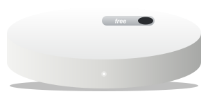 | 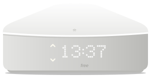 | 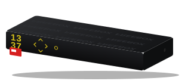 | 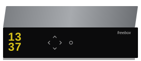 |
| `ultra` (v9) | `pop` (v8) | `delta` (v7) | `revolution` (v6) | `mini_4k` |

### Livebox (Orange)

| Livebox 7 | Livebox 6 | Livebox 5 | Livebox 4 | Livebox S |
|:---:|:---:|:---:|:---:|:---:|
|  |  |  |  |  |
| `livebox_7` | `livebox_6` | `livebox_5` | `livebox_4` | `livebox_s` |

### SFR Box

| SFR Box 8 | SFR Box 7 | SFR Box (NB6VAC) |
|:---:|:---:|:---:|
|  | 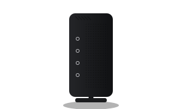 |  |
| `sfr_box_8` | `sfr_box_7` | `sfr_nb6vac` |

### Bbox (Bouygues Telecom)

The Bbox integration exposes no device model: set the picture with the `model` option.

| Bbox Fibre | Bbox Ultym | Bbox Miami |
|:---:|:---:|:---:|
| 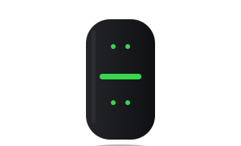 | 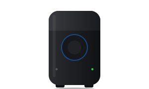 | 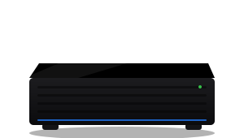 |
| `bbox_fibre` | `bbox_ultym` | `bbox_miami` |

## Screenshots

While the box is running, the card animates: the cooling fan spins at its live speed. It settles to a still card when it stops (and honours `prefers-reduced-motion`).

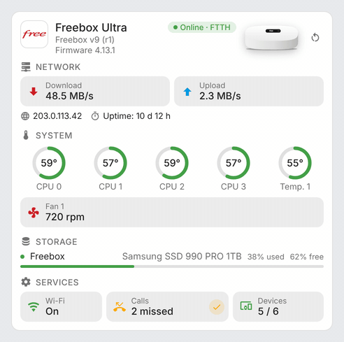

### Operators

The full card with what each integration exposes: the Freebox shows every section (rates, connection, temperatures, fan, storage, Wi-Fi, calls, devices, restart); the Livebox its line rates, Wi-Fi, missed calls (with the clear button), connected devices and restart button; the SFR Box its DSL line rates, temperature and restart button; the Bbox its bandwidth (picture set with `model: bbox_fibre`).

| Operator | Light | Dark |
|---|---|---|
| Freebox (Free) | 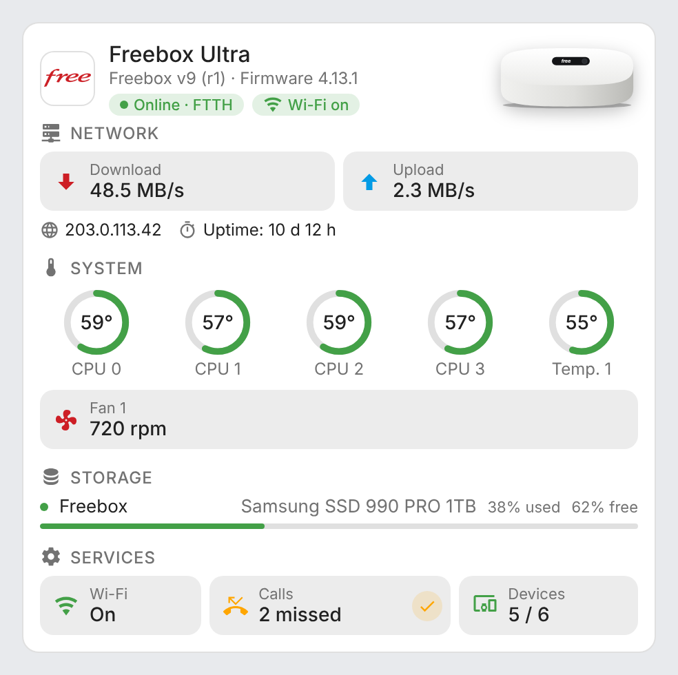 | 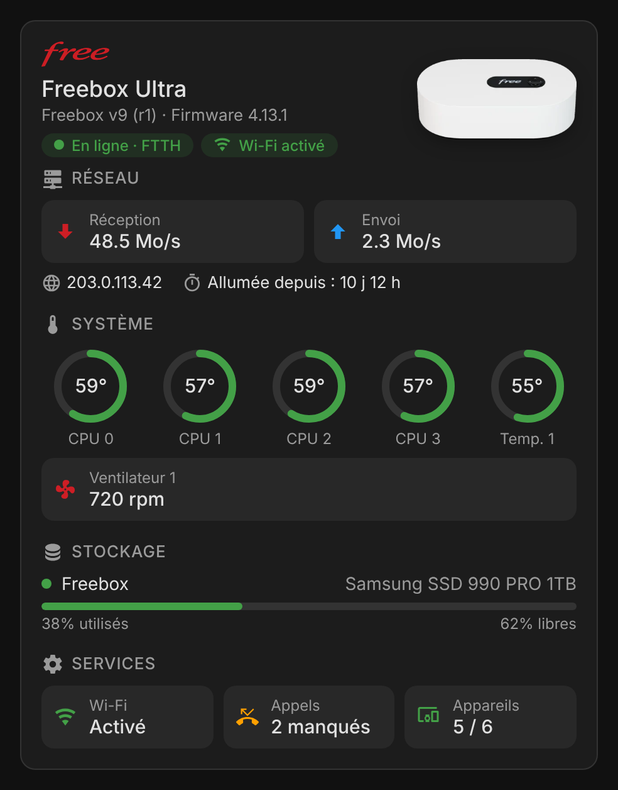 |
| Livebox (Orange) | 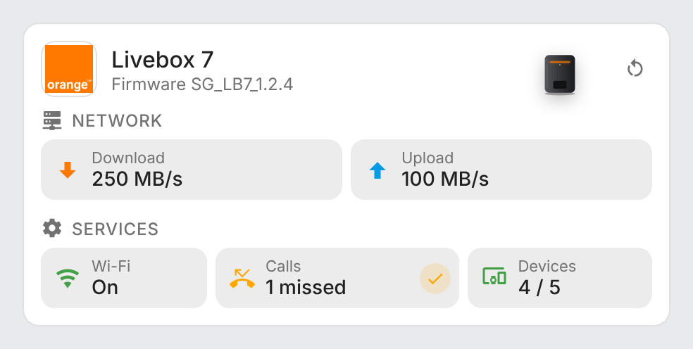 | 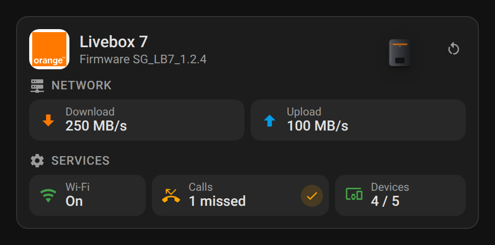 |
| SFR Box | 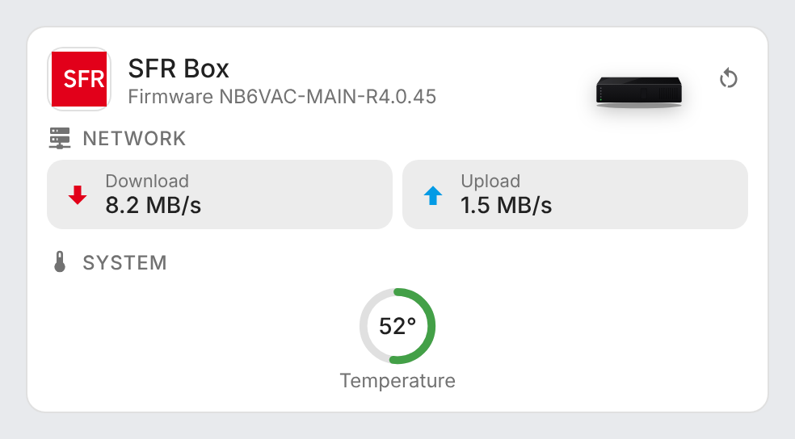 | 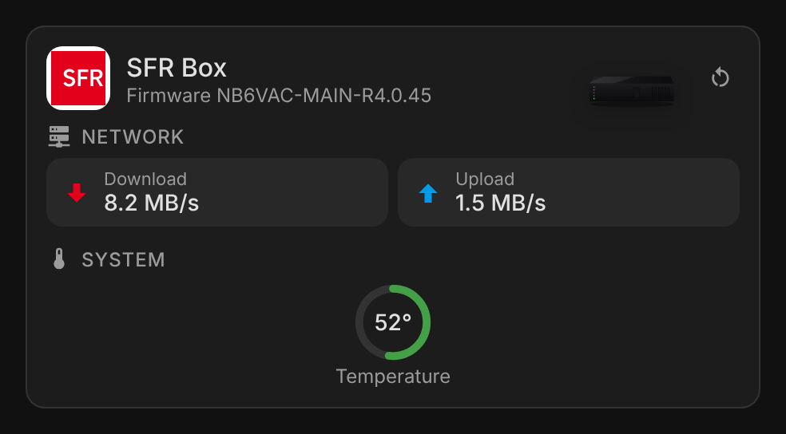 |
| Bbox (Bouygues Telecom) | 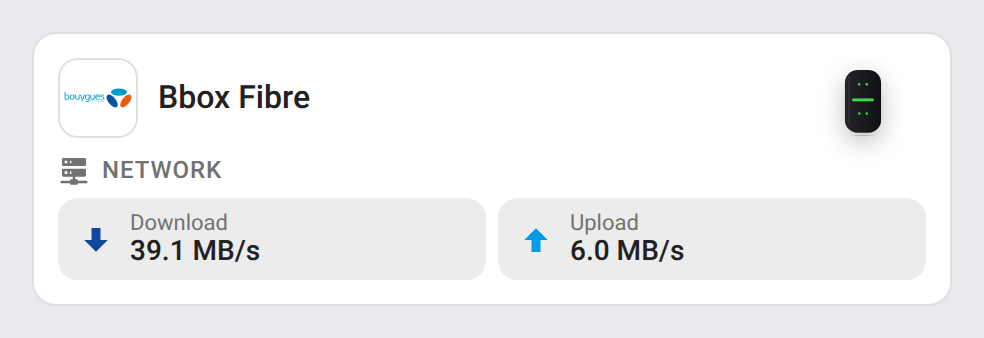 | 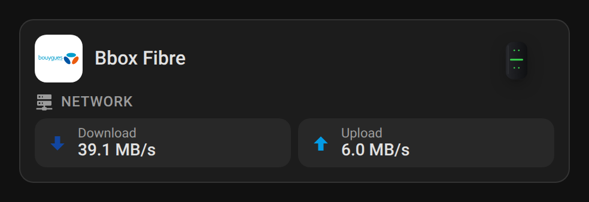 |

### Mini card

| Light | Dark |
|---|---|
| 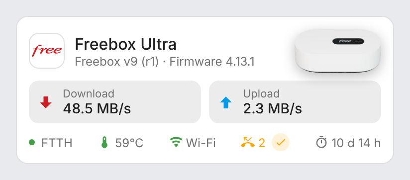 | 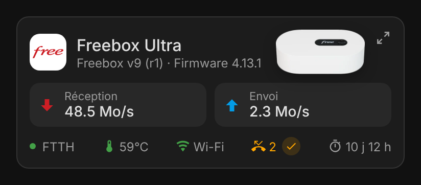 |
| 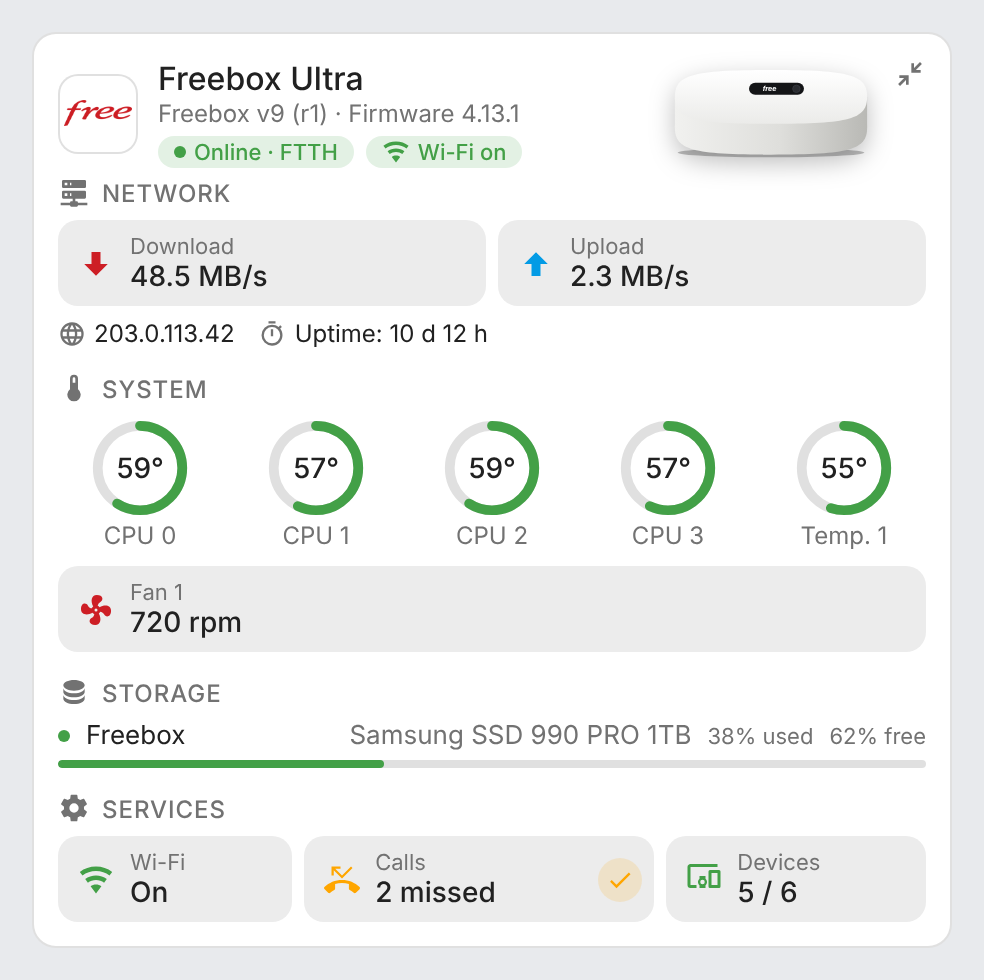 | 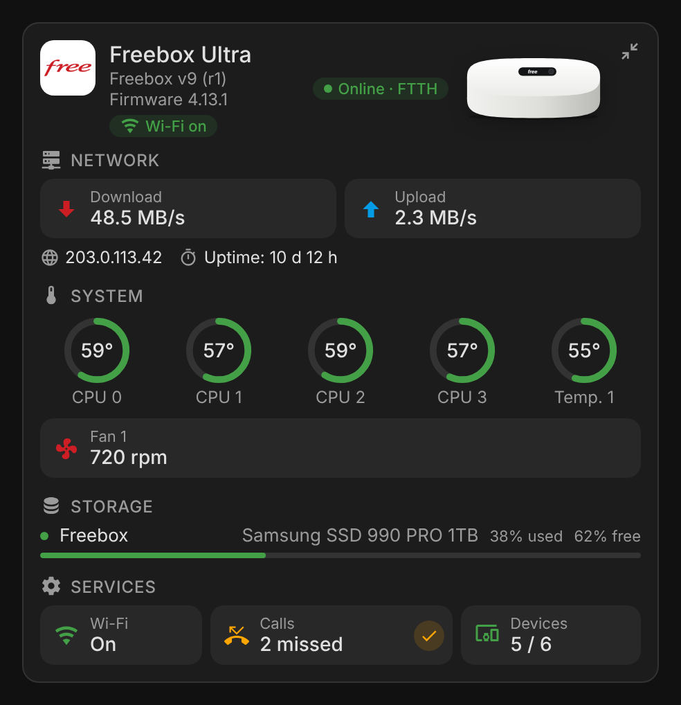 |

The second row is the mini card after a click on its detail button (top right): the full card, with the collapse button in the same place.

## How it works

The cards read the entity and device registries of Home Assistant and keep the entities of the supported box integrations (`freebox`, `livebox`, `sfr_box`, `bbox`). Each box's sensors are recognized by their integration's own translation keys (for the Freebox: `rate_down`, `rate_up`, `missed`, `wifi`, `partition_free_space`, `raid_degraded`), so entity ids translated in another language (for example `sensor.freebox_vitesse_de_telechargement`) and renamed entities are supported. The Bbox integration is a legacy YAML platform without devices nor unique ids, so its sensors are not in the entity registry: they are found in the states by their entity-id suffix (`_currently_used_download_bandwidth`…). The box picture and the header logo, colour and links follow the detected operator.

The box itself is the device of the download rate sensor. Temperature and fan sensors are recognized by their `temperature` device class and `rpm` unit, disk partitions by their parent device, and connected devices by the config entry they share with the box (with a single box, the connected devices trackers that have no device are counted too). The **mark calls as read** and **reboot** buttons are found by their translation key (the reboot button also by its `restart` device class). On a Freebox, the connection type, IP addresses and uptime come from the attributes of its `device_tracker`. The Freebox integration gives the boot date without a time zone, in the system time zone of the Home Assistant process, and the card reads it in the time zone of Home Assistant (**Settings → System → General**). Both match on Home Assistant OS and Supervised; in a Docker container, start Home Assistant with `TZ` set to the same time zone (for example `-e TZ=Europe/Paris`), otherwise the uptime is off by the UTC offset. When the registry is not available, English Freebox entity ids (`sensor.freebox_download_speed`…) are used as a fallback.

Thresholds:

| Value | Orange | Red |
|---|---|---|
| Temperatures | 75 °C | 90 °C |
| Disk usage | 80 % | 90 % |
| Missed calls | 1 | — |

## Development

```bash
npm install
npm run build        # bundles src/internet-box-card.js + the embedded logos (images/*.svg) into dist/internet-box-card.js
npm run check        # builds and checks the card (run in CI)
npm run screenshots  # renders the cards with mock data (scripts/mock-states.mjs, scripts/mock-operators.mjs) into screenshots/ (and fan.gif, needs ffmpeg)
```

`dist/` is not committed: `npm run build` creates it locally, CI builds it on every push, and the release workflow attaches the built file to the release, which is where HACS downloads it from.

### Releasing

1. Bump `version` in `package.json`
2. Add a `## <version>` section at the top of [CHANGELOG.md](CHANGELOG.md)
3. Push to `main`: the **Release** workflow builds the card, creates the tag and the GitHub release with the changelog section as notes, and attaches `internet-box-card.js` (and its `freebox-card.js` copy)

## Translations

The cards auto-detect the language from your Home Assistant settings. Currently supported:

| Language | Code |
|---|---|
| English | `en` |
| Français | `fr` |

Contributions for additional languages are welcome!

## License

[MIT](LICENSE)

Freebox and Free are trademarks of Free SAS, Livebox and Orange of Orange SA, SFR of SFR SA, Bbox and Bouygues Telecom of Bouygues Telecom SA. This project is not affiliated with any of them.
