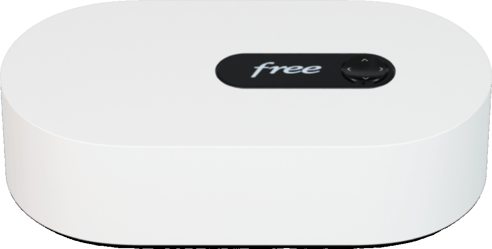

# ha-freebox-card

[](https://github.com/hacs/integration)
[](https://github.com/juju35/ha-freebox-card/actions/workflows/validate.yml)
[](https://github.com/juju35/ha-freebox-card/actions/workflows/build.yml)
[](https://github.com/juju35/ha-freebox-card/releases/latest)
[](LICENSE)

<p align="center"><br></p>

Lovelace cards for Home Assistant to monitor a Freebox: download / upload rates, connection, temperatures, fans, storage, Wi-Fi, missed calls and connected devices at a glance.

The cards are built on top of the [Freebox integration](https://www.home-assistant.io/integrations/freebox/) of Home Assistant: entities are **discovered automatically**, you don't have to pick them one by one.

[](https://my.home-assistant.io/redirect/hacs_repository/?owner=juju35&repository=ha-freebox-card&category=plugin)

| Freebox Card | Freebox Mini Card |
|---|---|
|  |  |

## Features

- Two cards: a full **Freebox Card** and a compact **Freebox Mini Card**
- Automatic discovery of the Freebox integration entities, whatever the language of the entity ids (several Freebox supported)
- Commercial model name (Freebox Ultra, Pop, Delta, Revolution, mini 4K) and firmware version
- Connection status and type (FTTH, xDSL…), public IPv4 (IPv6 on hover) and uptime
- Download / upload rates, in bytes (kB/s, MB/s) or bits (kb/s, Mb/s)
- Temperature gauges and fans speed
- Storage: free space of the disk partitions and RAID status
- Services: Wi-Fi state, missed calls and connected devices
- Colors turn orange / red when a threshold is crossed (temperatures, disk usage, missed calls)
- Click any value to open its Home Assistant history (more-info dialog)
- Click the Free logo to open free.fr, and the Freebox picture to open the Freebox OS admin interface
- Visual editor in the dashboard UI for both cards (no YAML needed)
- Light and dark mode, English and French
- Single file, no external dependency, the Freebox picture and the Free logo are embedded

## Prerequisites

The [Freebox integration](https://www.home-assistant.io/integrations/freebox/) must be configured (it is built into Home Assistant: **Settings → Devices & services → Add integration → Freebox**).

The connected devices count uses the `device_tracker` entities of the integration, which are disabled by default: enable the ones you want to follow.

## Installation

### Via HACS (recommended)

Click the button below to add the repository directly:

[](https://my.home-assistant.io/redirect/hacs_repository/?owner=juju35&repository=ha-freebox-card&category=plugin)

Then click **Download**, and reload your browser when HACS asks you to.

Or manually:

1. Open HACS → **⋮** (top right) → **Custom repositories**
2. Add `https://github.com/juju35/ha-freebox-card` — Type: **Dashboard**
3. Search for **Freebox Card** and click **Download**
4. Clear your browser cache and refresh

### Manual

1. Download `freebox-card.js` from the [latest release](https://github.com/juju35/ha-freebox-card/releases/latest) (or `dist/freebox-card.js` from this repository)
2. Copy it to `/config/www/freebox-card.js`
3. Go to **Settings → Dashboards → ⋮ → Resources** → Add resource:
   - URL: `/local/freebox-card.js`
   - Type: **JavaScript Module**
4. Clear your browser cache and refresh

## Configuration

### Visual editor

Edit a dashboard, click **Add card** and search for **Freebox Card** or **Freebox Mini Card**. The Freebox is preselected; pick another one in the list if you have several, set an optional title, choose the sections to display, the rate unit and the language. The preview updates live, and options left at their default are kept out of the generated YAML.

### Minimal

```yaml
type: custom:freebox-card
```

```yaml
type: custom:freebox-mini-card
```

### Full options

```yaml
type: custom:freebox-card
box: 0123456789abcdef0123456789abcdef
title: My Freebox
admin_url: https://mafreebox.freebox.fr
show_image: true
show_logo: true
show_network: true
show_system: true
show_storage: true
show_services: true
rate_unit: bits
language: fr
```

```yaml
type: custom:freebox-mini-card
box: 0123456789abcdef0123456789abcdef
title: My Freebox
admin_url: https://mafreebox.freebox.fr
show_image: true
show_logo: true
show_network: true
show_system: true
rate_unit: bits
language: fr
```

### Options reference

| Option | Card | Default | Description |
|---|---|---|---|
| `box` | both | First Freebox found | Freebox to display: its device id (only needed with several Freebox, pick it in the visual editor) |
| `title` | both | Freebox model | Card title |
| `admin_url` | both | `https://mafreebox.freebox.fr` | Freebox OS address opened when clicking the Freebox picture (for example `http://192.168.1.254`) |
| `show_image` | both | `true` | Show the Freebox picture |
| `show_logo` | both | `true` | Show the Free logo (opens free.fr when clicked) |
| `show_network` | both | `true` | Download / upload rates (and IPv4, uptime on the full card) |
| `show_system` | both | `true` | Temperatures and fans (hottest temperature on the mini card) |
| `show_storage` | full | `true` | Disk partitions and RAID status |
| `show_services` | full | `true` | Wi-Fi, missed calls and connected devices |
| `rate_unit` | both | `bytes` | Rates unit: `bytes` (kB/s, MB/s) or `bits` (kb/s, Mb/s) |
| `language` | both | Auto | Force language: `fr` or `en` (auto-detects from HA settings) |

## Screenshots

| Light | Dark (French) |
|---|---|
|  |  |
|  |  |

## How it works

The cards read the entity and device registries of Home Assistant and keep the entities of the `freebox` platform. Each sensor is recognized by its translation key (`rate_down`, `rate_up`, `missed`, `wifi`, `partition_free_space`, `raid_degraded`), so entity ids translated in another language (for example `sensor.freebox_vitesse_de_telechargement`) and renamed entities are supported.

The Freebox itself is the device of the download speed sensor. Temperature and fan sensors, named by the Freebox, are recognized by their `temperature` device class and `rpm` unit, disk partitions by their parent device, and connected devices by the config entry they share with the Freebox. The connection type, IP addresses and uptime come from the attributes of the Freebox `device_tracker`. When the registry is not available, English entity ids (`sensor.freebox_download_speed`…) are used as a fallback.

Thresholds:

| Value | Orange | Red |
|---|---|---|
| Temperatures | 75 °C | 90 °C |
| Disk usage | 80 % | 90 % |
| Missed calls | 1 | — |

## Development

```bash
npm install
npm run build        # bundles src/freebox-card.js + images/*.webp into dist/freebox-card.js
npm run check        # verifies dist/ is up to date (run in CI)
npm run screenshots  # renders the cards with mock data (scripts/mock-states.mjs) into screenshots/
```

### Releasing

1. Add a `## <version>` section at the top of [CHANGELOG.md](CHANGELOG.md)
2. Run the **Release** workflow from the Actions tab with that version

The workflow builds the card, creates the tag and the GitHub release with the changelog section as notes, and attaches `freebox-card.js`.

## Translations

The cards auto-detect the language from your Home Assistant settings. Currently supported:

| Language | Code |
|---|---|
| English | `en` |
| Français | `fr` |

Contributions for additional languages are welcome!

## License

[MIT](LICENSE)

Free and Freebox are trademarks of Free SAS. This project is not affiliated with Free.
